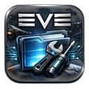
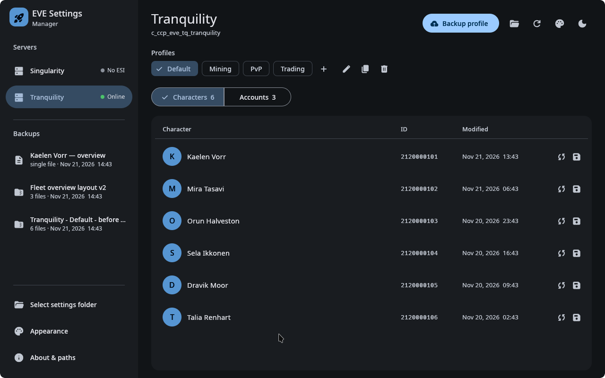
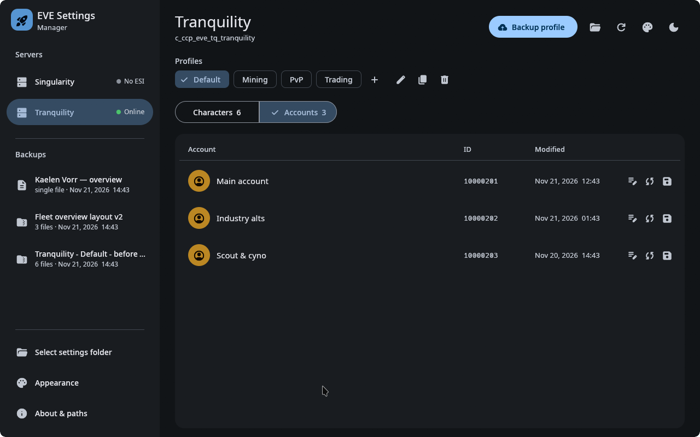
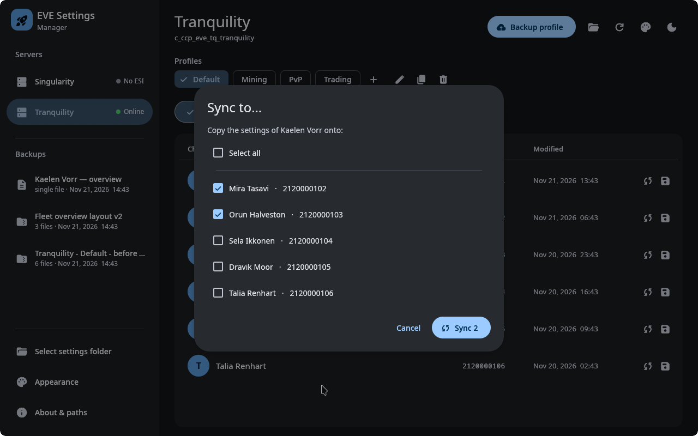
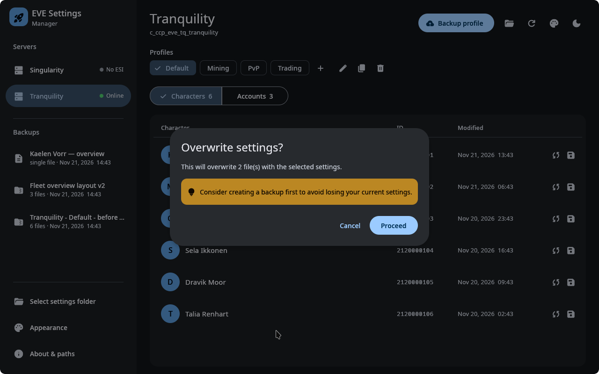
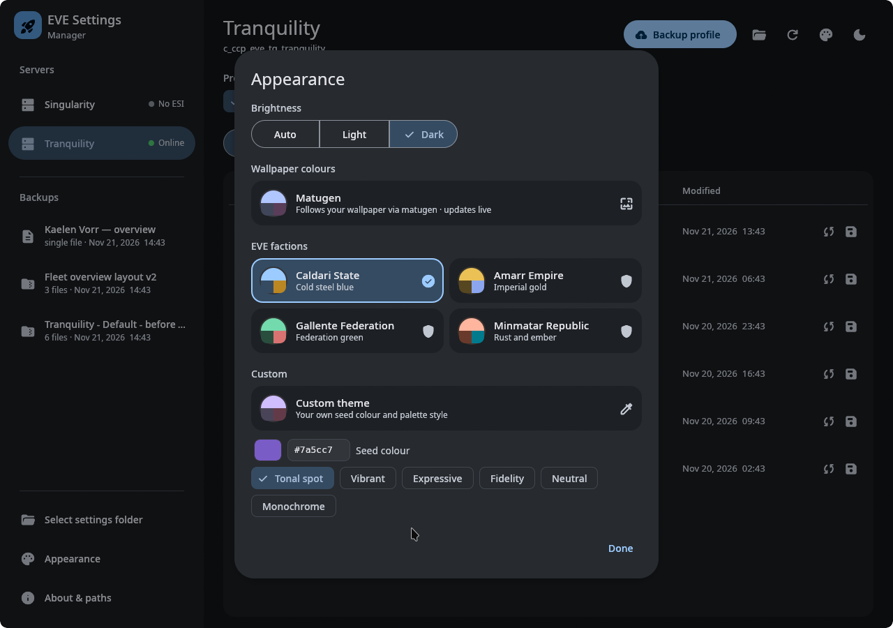
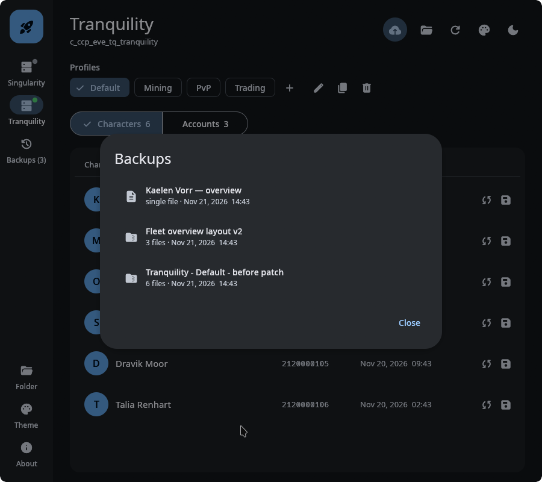
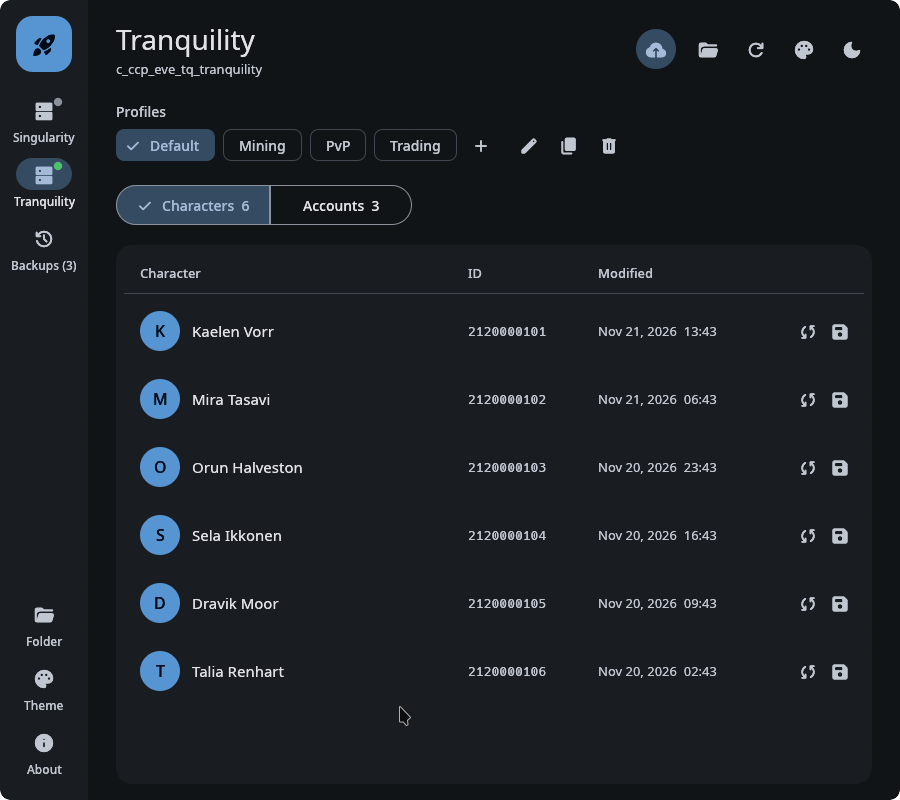
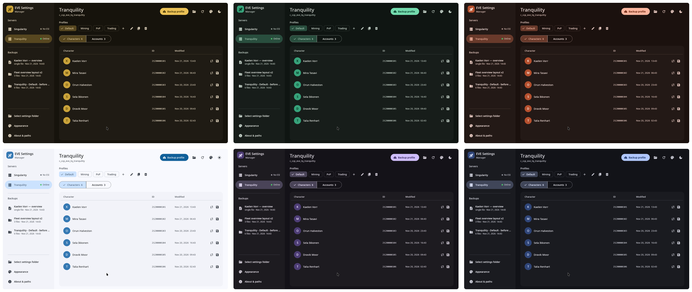

<div align="center">



# EVE Settings Manager

**Manage, sync and back up your EVE Online client settings: windows, overviews, chat and UI layouts. Native on Linux and Windows.**

[](https://github.com/tylort69/eve-settings-manager/actions/workflows/ci.yml)
[](https://github.com/tylort69/eve-settings-manager/releases/latest)
[](LICENSE)




</div>

EVE stores every character's and every account's UI layout in small `.dat`
files hidden in `%LOCALAPPDATA%\CCP\EVE` on Windows, or inside your
Wine/Proton prefix on Linux. This app finds them for you and lets you:
- copy one character's layout onto your alts in two clicks,
- keep separate setting **profiles** (PvP, mining, trading…),
- take **backups** before a patch or a big UI change.

It's a native Rust rewrite of Nick Ning's
[EVE Settings Manager](#credits). It doesn't use Electron or a webview. It's a
single small program with a Material You interface, EVE faction themes, and
on Linux it can follow your wallpaper through
[matugen](https://github.com/InioX/matugen). The Linux and Windows builds have
the same features.

---

## Contents

- [Features](#features)
- [Screenshots](#screenshots)
- [Installation](#installation) · [Windows](#windows)
- [Requirements](#requirements)
- [Quick start](#quick-start)
- [How it works](#how-it-works)
- [Using the app](#using-the-app)
- [Appearance and themes](#appearance-and-themes)
- [Settings reference](#settings-reference)
- [Where EVE keeps settings on Linux](#where-eve-keeps-settings-on-linux)
- [Hyprland and tiling WMs](#hyprland-and-tiling-wms)
- [Privacy](#privacy)
- [Troubleshooting](#troubleshooting)
- [Uninstalling](#uninstalling)
- [Building and development](#building-and-development)
- [Credits](#credits) · [License](#license)

## Features

| | |
|---|---|
| 🔍 **Auto-detection** | Finds `CCP/EVE` in Steam/Proton (including extra Steam libraries and Flatpak Steam), Lutris/umu, Heroic, Bottles and plain Wine prefixes. |
| 🌐 **Servers** | Tranquility, Singularity, Serenity, Infinity, Duality and Thunderdome, each with live ESI status. |
| 🗂️ **Profiles** | Create, rename, duplicate and delete `settings_*` profiles. |
| 👤 **Characters and accounts** | Character names come from ESI. You can add your own note to each account. |
| 🔁 **Sync** | Copy one character's (or account's) settings onto any number of others. |
| 💾 **Backups** | Snapshot a whole profile or a single file, then restore it with one click. Every backup is timestamped. |
| 🎨 **Material You** | A Material 3 interface themed by matugen, four EVE faction themes, or a custom colour, in light or dark. |
| 🪟 **Tiling-friendly** | Switches to a compact navigation rail when the window is tiled narrow. |
| 🔄 **Live refresh** | Picks up settings the game client writes while the app is open. |
| 🪶 **Lightweight** | One ~24 MB native binary. Uses Wayland or X11 directly. |

## Screenshots

<table>
  <tr>
    <td></td>
    <td></td>
  </tr>
  <tr>
    <td align="center"><sub>Accounts, with your own notes</sub></td>
    <td align="center"><sub>Sync one character's layout to your alts</sub></td>
  </tr>
  <tr>
    <td></td>
    <td></td>
  </tr>
  <tr>
    <td align="center"><sub>Every overwrite asks first and suggests a backup</sub></td>
    <td align="center"><sub>Appearance: matugen, faction or custom themes</sub></td>
  </tr>
  <tr>
    <td></td>
    <td></td>
  </tr>
  <tr>
    <td align="center"><sub>Backups</sub></td>
    <td align="center"><sub>Compact rail layout for tiled windows</sub></td>
  </tr>
</table>

**Themes.** Amarr, Gallente, Minmatar, Caldari (light), a custom theme, and matugen following the wallpaper:



> All screenshots use made-up demo pilots and accounts.

## Installation

### Windows

1. Download `eve-settings-manager-<version>-x86_64-windows.zip` from the
   [latest release](https://github.com/tylort69/eve-settings-manager/releases/latest).
2. Extract it anywhere (for example `Documents\EVE Settings Manager`) and run
   `eve-settings-manager.exe`. There's nothing to install. It's a single
   portable program.

Windows 10 or 11 (64-bit) is required. Windows SmartScreen may warn that the
app is from an unknown publisher, because the build isn't code-signed. Click
**More info → Run anyway**. You can check the download against the
`.sha256` file first, in PowerShell:

```powershell
Get-FileHash .\eve-settings-manager-*-x86_64-windows.zip -Algorithm SHA256
```

The app finds `%LOCALAPPDATA%\CCP\EVE` automatically. Its own preferences
and backups are kept in `%APPDATA%\eve-settings-manager`. Close EVE and the
launcher before changing settings, since the client overwrites the files when
it exits.

### Option A: prebuilt release (Arch and other rolling distros)

1. Download `eve-settings-manager-<version>-x86_64-linux.tar.gz` from the
   [latest release](https://github.com/tylort69/eve-settings-manager/releases/latest).
2. Verify and install:

```bash
sha256sum -c eve-settings-manager-*-x86_64-linux.tar.gz.sha256
tar xzf eve-settings-manager-*-x86_64-linux.tar.gz
cd eve-settings-manager-*-x86_64-linux
./install.sh
```

The prebuilt binary is built on Arch Linux and needs **glibc 2.44 or newer**.
On older or fixed-release distros (Ubuntu LTS, Debian, Fedora), use Option B.

### Option B: build from source (any distro)

```bash
git clone https://github.com/tylort69/eve-settings-manager.git
cd eve-settings-manager
./install.sh
```

`install.sh` builds a release binary with Cargo. Then it installs, for your
user only (no root):

| What | Where |
|---|---|
| Binary | `~/.local/bin/eve-settings-manager` |
| App-menu entry | `~/.local/share/applications/eve-settings-manager.desktop` |
| Icon | `~/.local/share/icons/hicolor/128x128/apps/eve-settings-manager.png` |
| matugen template *(only if matugen is installed)* | `~/.config/matugen/templates/eve-settings-manager.json`, plus an entry in `~/.config/matugen/config.toml`. The old config is backed up first. |

Installer options:

```text
./install.sh                 install (prebuilt binary if present, otherwise build with cargo)
./install.sh --no-matugen    install without touching your matugen config
./install.sh --uninstall     remove the app (keeps your notes, settings and backups)
```

### Option C: run without installing

```bash
cargo run --release
```

## Requirements

**To run:**

| Dependency | Needed for | Arch package |
|---|---|---|
| Wayland compositor **or** X11 | The window | – |
| Vulkan **or** OpenGL (EGL) drivers | Rendering (wgpu) | `vulkan-icd-loader` + your GPU's driver (`vulkan-radeon`, `nvidia-utils`, `vulkan-intel`), or `mesa` |
| `libxkbcommon` | Keyboard input | `libxkbcommon` (`libxkbcommon-x11` on X11) |
| `xdg-desktop-portal` + a backend | The *Select settings folder* dialog | `xdg-desktop-portal` with `-hyprland`, `-gtk`, `-kde` or `-gnome` |
| `fontconfig` *(optional)* | Uses your system's sans-serif font. Otherwise a built-in font is used | `fontconfig` |
| `xdg-utils` *(optional)* | *Open folder* buttons | `xdg-utils` |
| [`matugen`](https://github.com/InioX/matugen) *(optional)* | Wallpaper-based colours | `matugen` (extra) |
| Internet access *(optional)* | Character names and server status from EVE's public ESI API | – |

**To build:** Rust **1.97+** and Cargo (`sudo pacman -S rust`, or
[rustup](https://rustup.rs)). No other system development packages are needed.

## Quick start

1. **Launch EVE at least once** and log in each character, so the game creates
   its settings files.
2. **Close the EVE client.** It rewrites settings on logout, which would undo
   your changes.
3. Open **EVE Settings Manager**. Your server should be detected on its own. If
   it isn't, click **Select settings folder**.
4. Choose a **profile** (usually `Default`). Then, on the character whose
   layout you like, click **⟳ Sync** and tick the characters to copy it to.
5. Start EVE again. Your alts now share that layout.

> **Tip:** click **Backup profile** before syncing for the first time. Restoring
> is one click.

## How it works

EVE keeps its client settings per server, per profile:

```text
…/AppData/Local/CCP/EVE/
└── c_ccp_eve_tq_tranquility/        ← server folder (name comes from the install path)
    ├── settings_Default/            ← a profile
    │   ├── core_char_2120000101.dat ← one character's settings (windows, overview, chat…)
    │   ├── core_user_10000201.dat   ← one account's settings (graphics, audio, shortcuts…)
    │   ├── core_char__.dat          ← client defaults (left alone)
    │   └── core_user__.dat
    └── settings_PvP/                ← another profile
```

- **Character files** (`core_char_<characterID>.dat`) hold per-character UI:
  window positions, overview and brackets, chat channels, drone and fleet
  windows.
- **Account files** (`core_user_<accountID>.dat`) hold per-account settings:
  graphics, audio, keyboard shortcuts and general UI options.
- **Profiles** are complete `settings_<name>` folders.

Everything the app does is plain file copying inside that folder. It never
touches the game client, its memory or its network traffic.

## Using the app

### Servers

The navigation drawer lists every server folder it found, with a status dot:

| Dot | Meaning |
|---|---|
| 🟢 Online | ESI reports the server is up |
| 🔴 Offline | ESI unreachable or server down |
| ⚪ No ESI | Test servers (Singularity, Duality, Thunderdome) without a public status endpoint |

### Profiles

Profiles are shown as chips above the table. Click one to switch to it. The
buttons next to the chips do the following:

| Button | Action |
|---|---|
| **+** | New empty profile |
| ✏️ | Rename the selected profile |
| ⧉ | Duplicate the selected profile (copies all its files) |
| 🗑️ | Delete the selected profile. Asks first, and you can't delete the only profile. |

The app remembers the last profile you used on each server.

### Characters and accounts

Switch between the **Characters** and **Accounts** tabs. Each row shows the
name (or your note), the ID and the last-modified time, and has these actions:

| Button | Action |
|---|---|
| ⟳ **Sync** | Copy this file's settings onto other characters (or accounts) in the same profile. You choose which, or *Select all*. |
| 💾 **Back up** | Save a timestamped copy of just this file |
| 📝 **Note** *(accounts)* | Name an account, e.g. "Main" or "Industry alts". Account files only carry a number, so this makes them easy to tell apart. |

Character names are looked up once through ESI and then cached. New files
written by the client appear within a few seconds.

### Backups

| Type | Created with | Contains | Restores to |
|---|---|---|---|
| **Profile backup** | *Backup profile* (top bar) | Every `.dat` in the profile | The currently selected profile |
| **File backup** | 💾 on a row | One settings file | Its original filename in the selected profile |

Hover a backup in the drawer (or open **Backups** on the compact rail) to
**restore**, **show in folder** or **delete** it. Restoring always asks for
confirmation first. Backups are stored in
`~/.local/share/eve-settings-manager/backups/`.

## Appearance and themes

Open **Appearance** (the palette icon) to choose a colour source and brightness.
Changes apply instantly and are remembered.

| Source | Description |
|---|---|
| **Matugen** | Uses the Material You palette matugen generates from your wallpaper. It updates **live**: change wallpaper, and the app recolours within a second. |
| **EVE factions** | Caldari State (steel blue), Amarr Empire (gold), Gallente Federation (green), Minmatar Republic (rust). |
| **Custom** | Pick any seed colour (colour picker or `#hex`) and a palette style: *Tonal spot, Vibrant, Expressive, Fidelity, Neutral* or *Monochrome*. |

**Brightness:** *Auto* follows the mode matugen last ran with. For faction and
custom themes, Auto means dark. *Light* and *Dark* force one or the other.

**Default:** matugen if it's set up; otherwise **Caldari**.

Every palette, built-in or custom, is generated with
[material-colors](https://crates.io/crates/material-colors). That's the same
Material You engine matugen uses, so faction and custom themes look as finished
as wallpaper themes.

### Setting up matugen manually

`install.sh` does this for you. To do it by hand, copy
[`matugen/eve-settings-manager.json`](matugen/eve-settings-manager.json) to
`~/.config/matugen/templates/` and add this to `~/.config/matugen/config.toml`:

```toml
[templates.eve-settings-manager]
input_path = "~/.config/matugen/templates/eve-settings-manager.json"
output_path = "~/.config/eve-settings-manager/colors.json"
```

The template writes the `default`, `light` and `dark` palettes, so the
brightness switch works without re-running matugen.

## Settings reference

Preferences live in `~/.config/eve-settings-manager/config.json`. Everything
can be changed from the app, but you can also edit the file while the app is
closed.

| Key | Type | Description |
|---|---|---|
| `theme` | object or `null` | `{"kind":"matugen"}`, `{"kind":"faction","value":"caldari"\|"amarr"\|"gallente"\|"minmatar"}`, `{"kind":"custom"}`, or `null` for automatic |
| `theme_mode` | string | `"auto"`, `"light"` or `"dark"` |
| `custom_theme.seed` | string | Seed colour for the custom theme, e.g. `"#7a5cc7"` |
| `custom_theme.style` | string | `"tonal"`, `"vibrant"`, `"expressive"`, `"fidelity"`, `"neutral"`, `"monochrome"` |
| `custom_eve_folder` | string | Folder chosen with *Select settings folder*. Empty means auto-detect. |
| `last_active_server` | string | Server opened at start-up |
| `server_profiles` | map | Last-used profile per server folder |
| `descriptions` | map | Account notes, by account ID |
| `char_names` | map | Cached character names, by character ID |

Other files:

| Path | Contents |
|---|---|
| `~/.config/eve-settings-manager/colors.json` | matugen output (generated) |
| `~/.local/share/eve-settings-manager/backups/` | Profile backups (folders) and file backups (`.dat` + `meta.json`) |

On Windows, `config.json`, `colors.json` and `backups\` are all in
`%APPDATA%\eve-settings-manager`.

## Where EVE keeps settings on Linux

The app checks these locations automatically (`*` matches any prefix or user
name):

| Launcher | Path |
|---|---|
| Steam / Proton | `~/.steam/steam/steamapps/compatdata/8500/pfx/drive_c/users/steamuser/AppData/Local/CCP/EVE` |
| Steam (other libraries) | `<library>/steamapps/compatdata/8500/pfx/…` (read from `libraryfolders.vdf`) |
| Flatpak Steam | `~/.var/app/com.valvesoftware.Steam/.local/share/Steam/steamapps/compatdata/8500/pfx/…` |
| Lutris / umu | `~/Games/*/drive_c/users/*/AppData/Local/CCP/EVE` (also `~/Games/*/pfx/…`) |
| Heroic | `~/Games/Heroic/Prefixes/*/*/drive_c/users/*/AppData/Local/CCP/EVE` |
| Bottles | `~/.local/share/bottles/bottles/*/drive_c/users/*/AppData/Local/CCP/EVE` (and Flatpak Bottles) |
| Wine | `~/.wine/drive_c/users/*/AppData/Local/CCP/EVE` |

If several are found, the one with server data that was used most recently
wins. **About & paths** lists the others and lets you switch between them.

## Hyprland and tiling WMs

The window's class / app-id is **`eve-settings-manager`**.

Hyprland with the Lua config (0.53+):

```lua
hl.window_rule({
    name   = "eve-settings-manager",
    match  = { class = "^(eve-settings-manager)$" },
    float  = true,
    size   = "1200 760",
    center = true,
})
```

Hyprland with the classic `hyprland.conf`:

```ini
windowrule = float, class:^(eve-settings-manager)$
windowrule = size 1200 760, class:^(eve-settings-manager)$
windowrule = center, class:^(eve-settings-manager)$
```

Sway / i3:

```text
for_window [app_id="eve-settings-manager"] floating enable, resize set 1200 760
```

When tiled narrower than about 980 px, the app switches to a compact
navigation rail by itself.

## Privacy

- Everything stays on your machine. There is no telemetry and no account.
- The only network requests go to EVE's public ESI API (`esi.evetech.net`, or
  the Serenity/Infinity ESI for those servers):
  - **server status**, and
  - **character name lookup**, which sends only the character IDs found in your
    settings files. Names are cached afterwards.
- Account notes and backups are stored only in your local config and data
  folders.

## Troubleshooting

<details>
<summary><b>"EVE settings folder not found"</b></summary>

Launch EVE once and log in a character, so the folder gets created. If you use
an unusual prefix location, click **Select settings folder** and pick the
`…/AppData/Local/CCP/EVE` folder or a server folder inside it.
</details>

<details>
<summary><b>The "Select settings folder" dialog doesn't open</b></summary>

The folder picker goes through `xdg-desktop-portal`. Install it plus a backend
for your desktop, e.g. `xdg-desktop-portal-hyprland` and
`xdg-desktop-portal-gtk` on Hyprland, then log out and back in.
</details>

<details>
<summary><b>My synced settings were reverted</b></summary>

The EVE client writes its settings when a character logs out or the client
closes, so it overwrote the copied file. Close every EVE client before you sync
or restore.
</details>

<details>
<summary><b>Character names show as "Character 21…"</b></summary>

Names come from ESI. If you were offline or ESI was down, they'll fill in the
next time the profile loads with a connection. Account files never have names;
add a **note** instead.
</details>

<details>
<summary><b>Blank or black window / GPU errors</b></summary>

Try the OpenGL backend instead of Vulkan:

```bash
WGPU_BACKEND=gl eve-settings-manager
```

Make sure a Vulkan driver or Mesa (OpenGL/EGL) is installed.
</details>

<details>
<summary><b>The prebuilt binary says <code>GLIBC_2.44 not found</code></b></summary>

Your distribution has an older glibc. Build from source instead (Option B).
That takes a few minutes, with no extra dependencies besides Rust.
</details>

<details>
<summary><b>Matugen colours don't change</b></summary>

Check that `~/.config/matugen/config.toml` has the `[templates.eve-settings-manager]`
entry. Then run matugen once and confirm that
`~/.config/eve-settings-manager/colors.json` gets updated. Also check that
**Appearance → Matugen** is selected.
</details>

## Uninstalling

**Windows:** delete the extracted folder. To also remove your notes,
preferences and backups, delete `%APPDATA%\eve-settings-manager`.

**Linux:**

```bash
./install.sh --uninstall
```

This removes the binary, the menu entry, the icon and the matugen template
entry. Your notes, preferences and backups stay. Delete them with:

```bash
rm -rf ~/.config/eve-settings-manager ~/.local/share/eve-settings-manager
```

## Building and development

```bash
cargo build --release        # binary at target/release/eve-settings-manager
cargo test                   # file-operation and theme tests (uses a temp folder)
cargo clippy --all-targets   # lints (CI runs with -D warnings)
scripts/package.sh           # release tarball in dist/
scripts/package-windows.sh   # Windows .zip in dist/ (needs mingw-w64-gcc + rustup target x86_64-pc-windows-gnu)
```

Project layout:

| File | Purpose |
|---|---|
| `src/main.rs` | Window setup and fonts (fontconfig on Linux, Segoe UI on Windows) |
| `src/app.rs` | UI: drawer and rail, profiles, table, dialogs |
| `src/m3.rs` | Material 3 components (buttons, chips, segmented buttons, rail…) |
| `src/theme.rs` | Colour schemes: matugen loading, faction and custom generation, live reload |
| `src/eve.rs` | Folder discovery, profiles, settings files and backups |
| `src/esi.rs` | Background ESI requests |
| `src/store.rs` | Config file |
| `matugen/` | matugen template |

Debug builds accept `ESM_DEMO_VIEW=accounts|appearance|sync|backups|confirm`
to open a specific view at start-up; that's how the screenshots are made.
Combine it with `XDG_CONFIG_HOME`/`XDG_DATA_HOME` pointing at a demo folder
so your real data isn't shown.

Issues and pull requests are welcome. When reporting a bug, please replace
character names and IDs with placeholders.

## Credits

This project is a port of **EVE Settings Manager** by **Nick Ning**, released
under the MIT License (see [`LICENSE`](LICENSE)). The features, workflow and UI
text follow the original 2.0.6 release, and the app icon comes from it. Thanks
to Nick for the original app.

Built with [egui](https://github.com/emilk/egui),
[material-colors](https://github.com/Aiving/material-colors),
[Material Symbols](https://fonts.google.com/icons) (via
[egui_material_icons](https://crates.io/crates/egui_material_icons)) and
[matugen](https://github.com/InioX/matugen).

EVE Online and all related names are trademarks of CCP hf. This project is not
affiliated with or endorsed by CCP. Use it at your own risk and keep backups.

## License

[MIT](LICENSE) © Nick Ning (original), tylort69 (Linux port)
